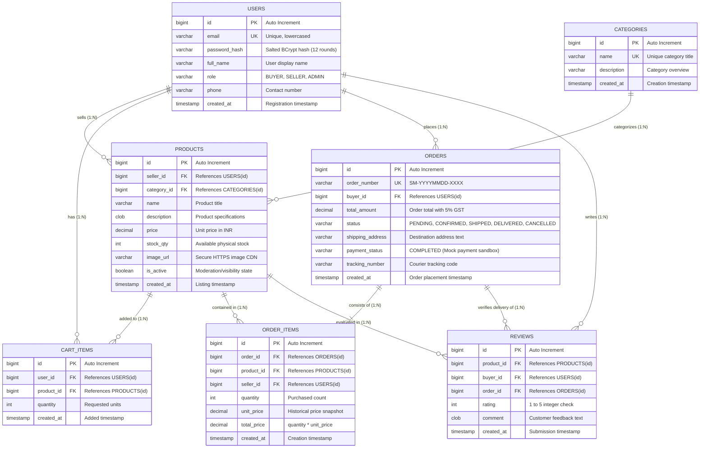

# D1: Entity-Relationship (ER) Diagram — SahanaMart

Anna University R2025 Semester 3 CSE Capstone Deliverable.  
**Student:** Sahana D  
**System:** SahanaMart Multi-Vendor E-Commerce Platform  

---

## 1. Relational Database Model Overview

The SahanaMart persistence tier is designed to support multi-vendor e-commerce with strict relational integrity, cascade protections, and index optimization. The core entity relationships are:

- **USERS** $\rightarrow$ **PRODUCTS**: One Seller owns many Products ($1:N$).
- **CATEGORIES** $\rightarrow$ **PRODUCTS**: One Category organizes many Products ($1:N$).
- **USERS** $\rightarrow$ **CART_ITEMS**: One User holds many Cart Items ($1:N$).
- **PRODUCTS** $\rightarrow$ **CART_ITEMS**: One Product can appear in multiple shopping carts ($1:N$).
- **USERS** $\rightarrow$ **ORDERS**: One Buyer places many Orders ($1:N$).
- **ORDERS** $\rightarrow$ **ORDER_ITEMS**: One Order contains multiple line items ($1:N$).
- **PRODUCTS** $\rightarrow$ **ORDER_ITEMS**: An Order Item references a specific snapshot of a Product ($1:N$).
- **PRODUCTS** $\rightarrow$ **REVIEWS**: One Product receives many customer reviews ($1:N$).
- **USERS** $\rightarrow$ **REVIEWS**: One Buyer writes verified reviews ($1:N$).
- **ORDERS** $\rightarrow$ **REVIEWS**: One delivered Order is linked to a Review to ensure verified purchase status ($1:1$ per product).

---

## 2. Mermaid Entity-Relationship Diagram

---

## 3. Schema Constraints & Data Integrity

1. **Composite Uniqueness**:
   - `CART_ITEMS`: `uk_cart_user_product UNIQUE (user_id, product_id)` ensures a buyer cannot duplicate rows; quantity is updated instead.
   - `REVIEWS`: `uk_reviews_buyer_order_product UNIQUE (buyer_id, order_id, product_id)` restricts each buyer to exactly one verified review per purchased delivered order item.
2. **Referential Cascade & Delete Rules**:
   - Deleting a category is restricted (`ON DELETE RESTRICT`) while products exist.
   - Deleting a user cascades to cart items (`ON DELETE CASCADE`), but preserves order history through restricted foreign keys (`ON DELETE RESTRICT`) to protect accounting integrity.
3. **Optimized Indexes**:
   - `idx_products_seller` on `products(seller_id)`
   - `idx_products_category` on `products(category_id)`
   - `idx_cart_user` on `cart_items(user_id)`
   - `idx_orders_buyer` on `orders(buyer_id)`
   - `idx_order_items_order` on `order_items(order_id)`
   - `idx_reviews_product` on `reviews(product_id)`
