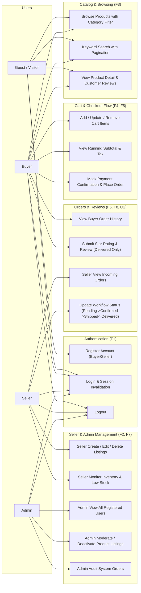

# D2: System Use Case Diagram — SahanaMart

Anna University R2025 Semester 3 Capstone Deliverable (Kickoff & Final Review).

## Actors
- **Buyer**: Registered consumer purchasing products, managing cart, viewing order history, leaving reviews.
- **Seller**: Merchant managing product listings, monitoring stock levels, and updating incoming order statuses.
- **Admin**: Platform administrator moderating listings, reviewing users, and viewing global transactions.
- **Guest / Visitor**: Unauthenticated user browsing catalog and signing up.

