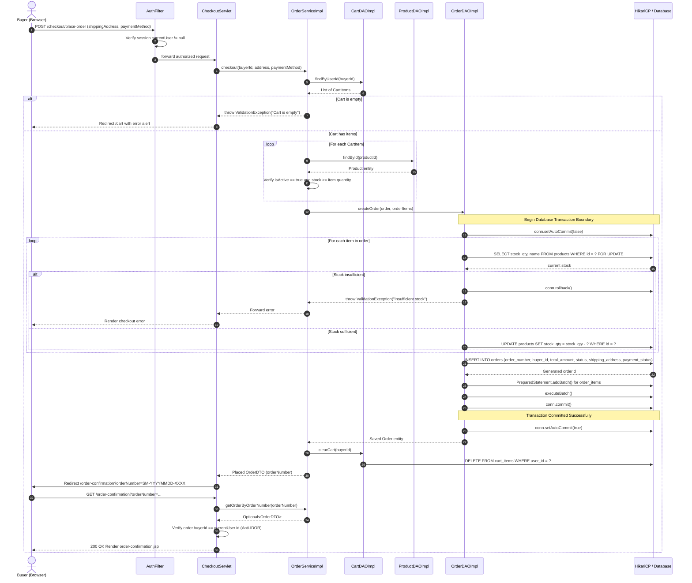

# D3: Place Order & Atomic Checkout Sequence Diagram — SahanaMart

Anna University R2025 Semester 3 CSE Capstone Deliverable.  
**Student:** Sahana D  
**Feature:** Atomic Checkout, Mock Payment Confirmation, and Inventory Deduction (F5)  

---

## 1. Sequence Overview

This diagram documents the end-to-end execution flow of the **Checkout & Order Placement** journey. It highlights:
- Server-side authentication and cart verification.
- Transaction management using JDBC connection boundaries (`setAutoCommit(false)`, `commit()`, and `rollback()`).
- Atomic stock check and deduction preventing overselling race conditions.
- Order and order item batch insertion.
- Cart cleanup and IDOR-safe redirection to the Order Confirmation page.

---

## 2. Mermaid Sequence Diagram

---

## 3. Key Architectural & Reliability Guarantees

1. **ACID Transaction Compliance**: Stock deduction, order generation, and item recording occur within a single database transaction. If any item fails validation or database error occurs, `conn.rollback()` executes, leaving database records in a consistent state.
2. **Server-Side Price Calculation**: Prices are never read from user forms. Prices are looked up strictly from persistent database catalog records to prevent price tampering attacks.
3. **Cart Invalidation**: Upon successful commit, `cartDAO.clearCart(buyerId)` runs to reset the buyer's active cart state.
4. **Anti-IDOR Authorization Check**: When viewing `/order-confirmation?orderNumber=...`, the server verifies `order.getBuyerId().equals(user.getId())` to prevent buyers from snooping other customers' orders.
